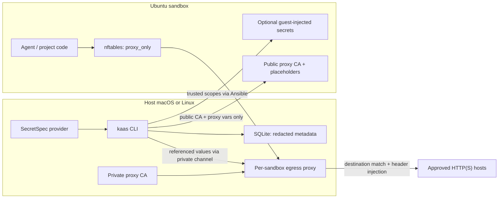

# KaaS — Koding Agent Application Sandbox (`kaas`)

<p align="center"></p>

**Persistent local Linux workspaces for coding agents.**

CLI and Ansible playbooks for disposable [Colima](https://colima.run) Ubuntu VMs — toolchains, explicitly trusted guest secrets, and coding agents in an isolated guest.

Docs: [https://stellar-technology-services.github.io/kaas/](https://stellar-technology-services.github.io/kaas/) (published from `docs/` on each `v*` tag).

## Install KaaS

KaaS runs on **macOS** and **Linux** hosts. Guests are always Ubuntu Colima VMs.
Full guides: [macOS](https://stellar-technology-services.github.io/kaas/guides/install-macos/) · [Linux](https://stellar-technology-services.github.io/kaas/guides/install-linux/).

### macOS (quick)

```bash
brew tap Stellar-Technology-Services/tools
brew install kaas
brew install ansible colima lima secretspec herdr
colima start && colima stop          # creates ~/.colima/_lima/_config/user
kaas init
kaas doctor
```

Or install a Darwin release binary (`arm64` / `amd64`) from
[GitHub Releases](https://github.com/Stellar-Technology-Services/kaas/releases),
then install the same Homebrew dependencies and run `kaas init`.

### Linux (quick)

Requires Ubuntu (or similar) with KVM. Full guide:
[Install on Linux](https://stellar-technology-services.github.io/kaas/guides/install-linux/).

```bash
sudo apt update
sudo apt install -y qemu-kvm qemu-system cpu-checker ansible curl ca-certificates jq
sudo usermod -aG kvm "$USER"   # then log out/in
kvm-ok

# Lima (adjust arch: x86_64 or aarch64)
VERSION=$(curl -fsSL https://api.github.com/repos/lima-vm/lima/releases/latest | jq -r .tag_name)
curl -fsSL "https://github.com/lima-vm/lima/releases/download/${VERSION}/lima-${VERSION#v}-Linux-x86_64.tar.gz" \
  | sudo tar Cxz - /usr/local

# Colima (adjust arch: x86_64 or arm64)
curl -fsSL -o /tmp/colima https://github.com/abiosoft/colima/releases/latest/download/colima-Linux-x86_64
sudo install /tmp/colima /usr/local/bin/colima

curl -sSL https://install.secretspec.dev | sh
curl -fsSL https://herdr.dev/install.sh | sh

sudo dpkg -i kaas_*_linux_amd64.deb   # or linux_arm64 from Releases
colima start && colima stop
kaas init
kaas doctor
```


### From source

**macOS:** install deps with Homebrew, then build.

```bash
brew install go ansible colima lima secretspec herdr
git clone git@github.com:Stellar-Technology-Services/kaas.git
cd kaas && make build
install -m 755 dist/kaas "$HOME/.local/bin/kaas"
kaas init
```

**Linux:** follow [Install on Linux](https://stellar-technology-services.github.io/kaas/guides/install-linux/)
for apt + release binaries, then:

```bash
sudo apt install -y golang-go   # or Go 1.22+ from https://go.dev/dl/
git clone git@github.com:Stellar-Technology-Services/kaas.git
cd kaas && make build
sudo install -m 755 dist/kaas /usr/local/bin/kaas
kaas init
```

Shell completion (optional):

```bash
kaas completion zsh > "${fpath[1]}/_kaas"
kaas completion bash > /usr/local/etc/bash_completion.d/kaas
```
## Get started

### 1. Add KaaS to a Git project

**Important:** A project contract is optional. After `kaas init`, you can run
sandboxes without `kaas project init` — use a project `kaas.yaml` only when you
need workspace checkout, setup scripts, published services, or project
egress/resource overrides.

```bash
cd ~/src/payments
kaas project init
```

This scaffolds the committed project contract:

```text
kaas.yaml
scripts/kaas-setup
```

The global `~/.kaas` workspace owns Ansible and application settings. Edit the
project resource/workspace contract and bootstrap script, then commit both.

### 2. Create a sandbox

```bash
kaas up my-app                 # VM, tools, agents, credential mode, setup
```

`kaas up` installs required Ansible Galaxy collections. In `open` mode it uses
the traditional optional guest-secret phase; in delegated modes it starts the
host proxy and installs only public/non-secret guest configuration.

KaaS provisions the Ubuntu release supplied by Colima. Create a fresh sandbox
to adopt a newer guest baseline instead of upgrading an existing guest in place.

### 3. Add secrets

```bash
secretspec config global init     # once — pick keyring
kaas secrets init
kaas secrets set ANTHROPIC_API_KEY
kaas secrets set GITHUB_TOKEN --sandbox my-app   # optional per-sandbox override
kaas secrets deploy my-app
```

### 4. Use it

```bash
kaas pubkey my-app             # SSH public key for GitHub
kaas ssh my-app
kaas list
```

### 5. Stop, resume, or destroy

```bash
kaas stop my-app                # stop VM; preserve disk, registry, and contract
kaas start my-app               # resume a stopped sandbox
kaas destroy my-app             # prompts before permanent deletion
kaas destroy my-app -y          # skip confirmation
kaas destroy my-app -y --force  # drop registry even if provider delete fails
```

Multiple sandboxes get unique SSH ports automatically:

```bash
kaas up project-a
kaas up project-b
kaas list
kaas ssh project-a
```

## Rationale

Coding agents (Pi, Oh My Pi) assume a full Linux toolchain, network access, and long-lived API credentials. Running them on a shared host shell fails in practice:

- **Host pollution.** Agents install packages, mutate PATH, write caches, and leave credentials in the user environment. One experiment contaminates every other project on the machine.
- **Non-reproducible Linux.** The host OS is often not the deployment target. Native builds, apt packages, and agent installers behave differently (or not at all) on Darwin, and even on Linux hosts you want isolation. Guests need a real Ubuntu userspace.
- **Multi-project concurrency.** Work on `project-a` and `project-b` at once needs separate disks, SSH ports, and often different API keys — not one shared VM or one `.env` file.
- **Secrets vs metadata.** API keys must never live in git or in a casual SQLite dump of “which VMs exist.” Declaration (which keys exist) and storage (keyring / provider) have to stay separate, with per-sandbox overrides.
- **Disposable by default.** Sandboxes should be cheap to create and safe to destroy. Machine lifecycle (`create` / `start` / `stop` / `fork` / `destroy`), guest readiness (`provision` / `agents` / `setup`), and credentials stay separate stages under one CLI — not a tribal Makefile.

`kaas` exists so each coding-agent workload gets an isolated, named, Ubuntu Colima guest with idempotent provisioning and SecretSpec-backed credentials — without teaching every developer a bespoke Ansible/Colima ritual.

Desired vs observed state lives in the registry: intent is not proof the VM is
up. `kaas list --refresh` reconciles with the provider and reports drift.

## Design



### Components

| Layer | Role |
|---|---|
| **`kaas` (Go CLI)** | UX and orchestration: allocate SSH ports, start/stop Colima, generate inventory, invoke Ansible, resolve SecretSpec, record events |
| **Colima / Lima** | Host-native Ubuntu VMs on macOS or Linux. Profiles and guest hostnames match the sandbox name (`kaas up my-app` → profile `my-app`, prompt `user@my-app`). SSH is published on the host as `127.0.0.1:<port>` |
| **Ansible playbooks** | Idempotent guest config: `ansible/setup.yml` (toolchains), `ansible/coding-agents.yml`, `ansible/deploy-secrets.yml`, `ansible/pubkey.yml` |
| **SQLite state** | User-global registry at `~/.kaas/state.db` — name, port, `repo_path` / `repo_name`, desired/observed lifecycle state, published services, action history. Not secrets |
| **SecretSpec** | Declares keys and stores values in a provider. Values can be explicitly deployed into a trusted guest or resolved only into the host proxy. |
| **Egress proxy** | Per-sandbox host process holding delegated values in memory; enforces destination rules and injects bearer/basic/named headers. Its private CA and control socket remain host-only. |
| **Ingress + DNS** | Host loopback HTTP reverse proxy (Host routing + catalog) and optional `*.kaas.test` DNS; SSH `-L` publishes `workspace.services`. |
| **Guest egress policy** | Public proxy CA, non-secret placeholders, and proxy variables; `proxy_only` adds nftables rules pinning the proxy IP/port for unprivileged workloads. |

### Control flow

1. **Trusted guest injection:** `kaas secrets deploy` resolves the selected
   SecretSpec scope, passes it through Ansible, and writes shell exports. The
   guest possesses these values.
2. **Delegated egress:** KaaS resolves only keys named by `inject_secret` and
   sends them to a per-sandbox host proxy over private stdin or its `0600`
   control socket. The guest receives only placeholders, proxy variables, and
   the public CA.
3. The proxy matches the HTTP(S) destination before replacing bearer, basic, or
   named headers. A reachable host without `inject_secret` receives no value.
4. `proxy_preferred` is bypassable. `proxy_only` pins the proxy IP/port in
   nftables for unprivileged guest workloads; guest root is outside the
   boundary.
5. Stop/start/destroy/fork keep host-private proxy state separate from VM and
   project state. Declared `workspace.services` sync into the host ingress on
   `up`/`start` (`*.kaas.test` Host routing; see
   [Local services](docs/src/content/docs/guides/services.md)). Optional
   management dashboard: `kaas ui` ([Local web UI](docs/src/content/docs/guides/ui.md)).

See [Delegated Egress](docs/src/content/docs/guides/egress.md) for why to choose
one credential path over the other and for complete setup instructions.

### Defaults and boundaries

- **Guest `$HOME`** comes from Ansible facts (`ansible_user_dir`). Colima/Lima often uses `/home/<user>.guest`, not `/home/<user>`.

## Commands

`kaas --help` groups flat commands by operator stage (host → machine → guest →
credentials → access → observe), listing each group in likely usage order.
`kaas up` is the one-shot path; lower-level machine and guest commands remain
available. Paths stay flat (`kaas create`, not `kaas vm create`).

### Host setup

| Command | Description |
|---|---|
| `kaas init` | Initialize `~/.kaas`: clone Ansible from git (default `https://github.com/Stellar-Technology-Services/ansible`), install config and SecretSpec; `--dir`, `--ansible-repo` |
| `kaas project init` | Scaffold a Git project workspace contract |
| `kaas config show` | Print resolved configuration and its sources |
| `kaas deps` | Show host dependencies for this OS; `--install` installs missing ones |
| `kaas deps galaxy` | Manually refresh Ansible Galaxy collections (`kaas up` installs them automatically) |
| `kaas completion …` | Shell completion |

### Machine lifecycle

| Command | Description |
|---|---|
| `kaas up <name>` | Install dependencies, create VM, provision toolchains, agents, optional secrets, and workspace setup |
| `kaas create <name>` | Create / start Colima VM |
| `kaas start [name]` | Start a stopped sandbox with its existing disk and registry entry |
| `kaas stop [name]` | Stop the Colima VM while preserving its disk and registry entry |
| `kaas fork <sandbox-id> <new-name>` | Clone an existing sandbox VM under a new name |
| `kaas destroy [name]` | Confirm, then delete the VM and registry row; retains registry on provider failure unless `--force` |

### Guest readiness

| Command | Description |
|---|---|
| `kaas provision [name]` | Install packages and language toolchains |
| `kaas agents [name]` | Install coding agents |
| `kaas setup [name]` | Run configured project checkout and bootstrap commands/playbook |
| `kaas check [name]` | Dry-run provision (`ansible --check`) |

### Secrets and egress

| Command | Description |
|---|---|
| `kaas secrets init` | Verify `secretspec.toml` and print setup hints |
| `kaas secrets set KEY` | Store a secret (`--sandbox` = profile) |
| `kaas secrets deploy [name]` | Resolve SecretSpec and sync onto the VM |
| `kaas secrets check` | `secretspec check` for a profile |
| `kaas egress plan` | Print the versioned project egress policy without resolving or printing credentials |
| `kaas egress configure [name]` | Start the host proxy, install its public CA/proxy environment, and enforce configured topology |
| `kaas egress status [name]` | Show redacted runtime/CA/policy status |
| `kaas egress reload [name]` | Re-resolve delegated SecretSpec values into the proxy over a private socket |
| `kaas egress verify [name]` | Run proxy-only direct-IP/DNS/raw-socket/clean-environment bypass probes |
| `kaas pubkey [name]` | Generate / print sandbox SSH public key |

### Sandbox access

| Command | Description |
|---|---|
| `kaas ssh [name]` | SSH into the VM |
| `kaas cp <source> <destination>` | Copy a file between host and one sandbox |
| `kaas ping [name]` | Ansible ping |
| `kaas services list [name]` | List published sandbox services (`*.kaas.test`) |
| `kaas services sync [name]` | Allocate host ports, SSH forwards, reload ingress |
| `kaas services open [name] <service>` | Print (and try to open) a service URL |
| `kaas services status` | Show ingress runtime status |
| `kaas dns enable` / `disable` / `status` | Install or remove local `*.kaas.test` DNS hooks |
| `kaas ui` / `serve` | Run the localhost management dashboard (foreground) |
| `kaas ui start` / `stop` / `status` / `open` | Background dashboard daemon |

### Inspect and diagnose

| Command | Description |
|---|---|
| `kaas list` | List all sandboxes (`ls`) |
| `kaas inspect [name]` | Show stored and current facts for a sandbox |
| `kaas doctor [name]` | Check host prerequisites and optional sandbox connectivity |
| `kaas events [name]` | Show recorded sandbox lifecycle events |

### Additional

| Command | Description |
|---|---|
| `kaas version` | Print version |

Global flags: `--config`, `--state`, `--verbose`, `--quiet`, `--jsonl`.

Human-readable tables and status panels use color via lipgloss when the terminal
supports it. Set `NO_COLOR=1` or `TERM=dumb` for plain text; `--jsonl` emits
structured events instead.

If `[name]` is omitted and exactly one sandbox is registered, that name is used.

```bash
kaas list                     # NAME PORT DESIRED OBSERVED REPO REPO PATH
kaas list --refresh           # reconcile; report discrepancies (no silent rewrite)
kaas list --repo kaas
kaas list --jsonl
kaas create my-app --port 6025 --cpus 6 --memory 12 --disk 80
kaas stop my-app              # desired=stopped; resume with kaas start my-app
```

`kaas create` is a raw machine-lifecycle operation (Colima + state DB only).
`kaas up` and `kaas provision` require the configured Ansible assets.

New sandbox names must be lowercase letters, digits, and internal hyphens only
(for example `my-app`), at most 63 characters. Names such as `default`, paths,
whitespace, underscores, dots, and uppercase are rejected. Existing registry
rows with looser names keep working.

Without `--port`, the next free port from `defaults.ssh_port_base` (default `6022`) is chosen using the state DB and existing Colima profiles.

Fork an existing sandbox (the source is briefly stopped while its guest disk is cloned;
the new sandbox receives a new SSH port; the source returns to its prior observed state):

```bash
kaas fork my-app my-app-copy
kaas ssh my-app-copy
```

Forking does not copy SecretSpec values or host egress runtime. Deploy shared or
per-sandbox secrets explicitly with `kaas secrets deploy my-app-copy`.

## File transfer

```bash
kaas cp my-app:~/workspace/payments/test-report.xml ./
kaas cp ./patch.diff my-app:~/workspace/payments/
```

`kaas cp` uses the stored SSH facts for the named sandbox and `scp` to copy in
either direction. Exactly one path must be written as `sandbox:path`.

## Inspectability and diagnosis

```bash
kaas inspect my-app
kaas doctor
kaas doctor my-app
kaas events my-app
kaas events my-app --limit 20 --jsonl
```

`inspect` shows a sandbox's recorded resources, SSH facts, repository, and
desired/observed lifecycle state. `doctor` checks host prerequisites and, with a name,
sandbox SSH/Ansible connectivity; failed checks include repair advice. `events`
exposes the persisted lifecycle audit trail without exposing secret values.

`kaas up` records each readiness phase while preserving the VM if one fails:

```text
create → dependencies → provision → agents → secrets/egress → checkout → setup
```

Use `kaas events <name>` to identify the failed phase, `kaas doctor <name>` for
repair guidance, then rerun the relevant stage command (`provision`, `agents`,
`setup`, …) or `kaas up <name>`.

## Automation output

Use the global `--jsonl` flag with any command when an agent or script consumes
its output. stdout then contains only newline-delimited JSON records, ending in
a `result` record; logs and invoked-tool output stay on stderr. To make that
the default for a user or project workspace, set `output.jsonl: true` in
`kaas.yaml`; `false` retains text output unless `--jsonl` is passed.

```bash
kaas list --jsonl
kaas --jsonl up my-app
```

Use `-y` with destructive automation; JSONL is not an
interactive replacement for `kaas ssh` or `kaas secrets set`.

## Inspect effective configuration

```bash
kaas config show
kaas config show --jsonl
```

This displays the configuration KaaS will use after applying built-in, global
workspace, project, environment, and flag overrides, plus the user and project
configuration files that supplied it.

## VM resource defaults

Set user-wide resources in `~/.kaas/kaas.yaml`, then override only what a
specific repository needs in its project `kaas.yaml`:

```yaml
# User defaults (~/.kaas/kaas.yaml)
defaults:
  cpus: 4
  memory_gib: 8
  disk_gib: 64

# Project override (./kaas.yaml)
defaults:
  cpus: 8
  memory_gib: 16
  disk_gib: 120
```

The project config wins over user defaults; `kaas create --cpus --memory --disk`
wins for a single new sandbox. Existing stopped sandboxes retain their recorded
resources when started again. Project files may contain only these resource
overrides and `workspace`; KaaS rejects `state`, `paths`, `ansible`, `output`,
and other application-owned settings there.

## Project workspace setup

Keep KaaS’s base Ansible provisioning reusable and declare repository-specific
checkout, dependencies, services, and migrations in `kaas.yaml`. `kaas up`
runs the configured setup after agents and SecretSpec credentials; rerun it
with `kaas setup [name]`.

```yaml
workspace:
  git_auth: agent
  sources:
    - repository: git@github.com:acme/payments.git
      branch: main
      directory: ~/workspace/payments
    # - repository: git@github.com:acme/payments-api.git
    #   directory: ~/workspace/payments-api
  # KaaS clones every sources[] entry; scripts/kaas-setup runs in sources[0].
```

KaaS runs the repository-owned executable `./scripts/kaas-setup` after checkout
and optional Varlock validation (primary source only). The canonical repository includes an empty,
commented starter at that path. Make it idempotent; never place secret values
in the script.

### Private repository checkout

By default, `workspace.git_auth: agent` forwards the host SSH agent only for
the guest Git checkout. Start `ssh-agent` and add an authorized key on the host
before `kaas up`; KaaS does not copy that private key into the guest. Choose
`guest_key` after authorizing the key printed by `kaas pubkey`, `https` for an
HTTPS repository with guest credentials, or `none` for public/project-managed
authentication.

KaaS persists the managed repository URL, branch, guest directory, resolved
commit when available, setup result, and configuration source with the sandbox.
Use `kaas inspect <name>` to view them; `kaas list --repo <url>` filters by the
managed workspace repository.

### Optional Varlock environment contract

Projects using [Varlock](https://varlock.dev/) can validate a checked-in,
agent-safe `.env.schema` before their setup script runs:

```yaml
workspace:
  varlock:
    schema: .env.schema
    validate_command: varlock load --agent --summary-stderr
  sources:
    - repository: git@github.com:acme/payments.git
      directory: ~/workspace/payments
```

KaaS records the resulting `environment` phase and keeps the sandbox when
validation fails. Varlock's agent mode redacts sensitive values; KaaS does not
install Varlock or replace SecretSpec. Let the repository setup script run
`varlock run -- <command>` when it needs Varlock's resolved environment.

## Configuration

- Project: `kaas.yaml` in the ansible repo root — see [`kaas.example.yaml`](kaas.example.yaml)
- User: `~/.kaas/kaas.yaml (workspace)`
- Precedence: flags > `KAAS_*` env > project > user > built-ins

| Concern | Default |
|---|---|
| State DB | `~/.kaas/state.db` (`--state` / `KAAS_STATE_PATH`) |
| SSH port base | `6022` |
| VM size | 4 CPUs / 8 GiB / 64 GiB, `aarch64` |

## Secrets ([SecretSpec](https://secretspec.dev/))

Contract: committed [`secretspec.toml`](secretspec.toml). Values live in a provider (recommended: `keyring://` after `secretspec config global init`).

| Profile | Meaning |
|---|---|
| `default` | Shared keys for every sandbox |
| `<sandbox>` | Per-instance overrides (same name as `kaas create <name>`) |

Keyring path: `secretspec/kaas/{profile}/{KEY}`.

```bash
secretspec config global init     # once — pick keyring
kaas secrets init
kaas secrets set ANTHROPIC_API_KEY
kaas secrets set GITHUB_TOKEN --sandbox my-app
kaas secrets deploy my-app         # merges default ∪ my-app
kaas secrets check --sandbox my-app
```

Declared keys: `ANTHROPIC_API_KEY`, `OPENAI_API_KEY`, `GITHUB_TOKEN`, `OPENROUTER_API_KEY`, `GOOGLE_API_KEY`, `DEEPSEEK_API_KEY`. Scopes: `agents`, `github`.

Deploy writes non-empty values to `~/.profile.d/agent-secrets.sh` on the guest.

### Choose guest injection or delegated egress

- Use `kaas secrets deploy --scope <trusted-scope>` when a trusted guest process
  must read a value or the credential is non-HTTP, such as SSH, a database
  protocol, mTLS, signing, or encryption.
- Use `proxy_preferred` for proxy-compatible HTTP(S) credentials when direct
  network compatibility is still required. The guest cannot read the delegated
  value, but networking remains bypassable.
- Use `proxy_only` for untrusted unprivileged guest code requiring allowlisted
  HTTP(S). Guest root/`CAP_NET_ADMIN` remains outside the boundary.

A host can be reachable without receiving a credential. Explicitly running
`kaas secrets deploy` always makes the selected scope guest-readable; use
separate scopes for delegated and trusted guest values. See the
[Delegated Egress guide](docs/src/content/docs/guides/egress.md).

## What gets installed

- **System**: build-essential, git, curl, jq, ripgrep, fd, fzf, tmux, cmake, clang, …
- **GitHub CLI**: `gh` (official apt repo)
- **Python**: python3, pip, venv, uv
- **Node.js**: Node 22 LTS, pnpm, yarn, typescript, tsx
- **Go**: `/usr/local/go`
- **Rust**: rustup stable (rustfmt, clippy)
- **Herdr**: terminal-native coding-agent multiplexer ([herdr.dev](https://herdr.dev))
- **Coding agents** (`kaas agents`): [Pi](https://pi.dev), [Oh My Pi](https://omp.sh), [Prime Agent](https://github.com/PrimeIntellect-ai/prime-agent)

Versions and lists: `ansible/group_vars/all.yml`. Tool toggles: `install_herdr`. Agent toggles: `install_pi`, `install_oh_my_pi`.

## Playbooks

All Ansible-owned files—including the configuration, inventory, playbooks, Galaxy requirements, and group variables—live under `ansible/`. `kaas` generates inventory per run; playbooks do the provisioning:

| Playbook | Command |
|---|---|
| `ansible/setup.yml` | `kaas provision` / `kaas up` |
| `ansible/coding-agents.yml` | `kaas agents` |
| `ansible/deploy-secrets.yml` | `kaas secrets deploy` |
| `ansible/pubkey.yml` | `kaas pubkey` |
| `ansible/egress.yml` | `kaas egress configure` / delegated `kaas up` |

## Canonical workspace assets

`kaas.example.yaml` and `secretspec.toml` are embedded into the compiled CLI;
`kaas init` installs them into `~/.kaas`. Ansible is seeded by cloning a git
repository into `~/.kaas/ansible/` (default
`https://github.com/Stellar-Technology-Services/ansible`; override with the init prompt or
`--ansible-repo`). The in-repo `ansible/` tree is for local development and
upstream sync.

## Layout

```
cmd/kaas/                  CLI entrypoint
internal/cli/             commands
internal/config/          kaas.yaml loading
internal/state/           SQLite registry
internal/ingress/         Host HTTP ingress, DNS stub, SSH forwards
internal/egress/          Delegated egress proxy runtime
internal/colima/          Colima wrappers
internal/ansible/         playbook runner + inventory
internal/secretspec/      SecretSpec CLI client
internal/sandbox/         port allocation
kaas.example.yaml          example project config
secretspec.toml           secret contract (values not in git)

ansible/                  Ansible playbooks, inventory, config, and defaults
```


## Frequently Asked Questions

See the [Ansible guide](docs/src/content/docs/guides/ansible.md) for why playbooks
are required and how to extend the baseline, and the
[KaaS FAQ](docs/src/content/docs/faq.md) for Ansible ownership, per-user
configuration, project customization boundaries, Colima escape hatches for
stray VMs, and why the base Ansible configuration is shared instead of copied
into every project.

## Development

```bash
make build    # → dist/kaas
make test
make vet
make check    # vet + test
make install  # → /usr/local/bin/kaas
make clean
```

Or directly: `go test ./...` / `go build -o dist/kaas ./cmd/kaas`.


## Releases (macOS and Linux)

Push a `v*` tag to build and publish release artifacts with GoReleaser. The
leading `v` is omitted from the package version, so `v0.1.0` produces version
`0.1.0`:

```bash
git tag v0.1.0
git push origin v0.1.0
```

Releases include Darwin and Linux binaries for `arm64` and `amd64`, plus
checksums. See [Development](docs/src/content/docs/development.md) for
installation details.
