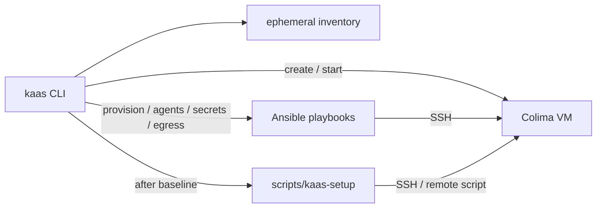

KaaS uses [Ansible](https://docs.ansible.com/) to configure every sandbox guest
over SSH. The Go CLI owns machine lifecycle (Colima create/start/stop) and
orchestration; Ansible owns **idempotent guest state** — packages, toolchains,
agents, secrets delivery, and egress plumbing.

## Why Ansible is required

A Colima VM alone is an empty Ubuntu disk. Without a guest provisioner, every
sandbox would need a one-off shell ritual that:

- is hard to re-run safely after drift or a fork;
- diverges between developers and projects;
- mixes host orchestration with in-guest package installs;
- cannot dry-run or converge the same desired state twice.

Ansible is a **hard dependency** of guest readiness commands (`kaas provision`,
`kaas agents`, `kaas secrets deploy`, `kaas egress configure`, `kaas check`,
and the guest phases inside `kaas up`). Host prerequisites are checked by
`kaas doctor` (`ansible`, `ansible-playbook`, `ansible-galaxy`).

KaaS does not replace Ansible with cloud-init, Dockerfile layers, or
`scripts/kaas-setup` for the shared baseline. Those tools solve different
problems (first boot, container images, project bootstrap).

## Why Ansible is used here

| Concern | Owner |
|---|---|
| Allocate SSH port, start/stop Colima, registry, contracts | `kaas` CLI |
| Idempotent Ubuntu baseline (apt, Go, Node, Rust, agents, …) | Ansible playbooks |
| Project checkout and app-specific bootstrap | `scripts/kaas-setup` |
| Secret declaration / keyring | SecretSpec |
| When to inject vs delegate credentials | `kaas` + playbooks (`deploy-secrets.yml` / `egress.yml`) |

Ansible fits because:

- **SSH is already the sandbox boundary.** KaaS publishes guest SSH on
  `127.0.0.1:<port>`; Ansible runs against that inventory the same way a human
  would `ssh` in.
- **Idempotence.** Re-running `kaas provision` converges toolchains without
  rebuilding the VM. `kaas check` uses Ansible check mode as a best-effort dry run.
- **One shared baseline.** All sandboxes on a machine share
  `~/.kaas/ansible/` so “what is a KaaS guest?” stays consistent. Projects do
  not fork playbooks; they extend via `scripts/kaas-setup`.
- **Security-sensitive guest wiring stays declarative.** Public proxy CA,
  placeholders, and nftables rules live in playbooks with stable names the CLI
  expects — not in ad-hoc project shell.



Live assets after `kaas init` live under `~/.kaas/ansible/` (cloned from
[Stellar-Technology-Services/ansible](https://github.com/Stellar-Technology-Services/ansible) by default). The
canonical playbook map is in [Playbooks](../reference/playbooks/).

## What Ansible owns vs what the project owns

| In user Ansible (`~/.kaas/ansible/`) | In the Git project |
|---|---|
| `setup.yml`, `coding-agents.yml`, `group_vars/all.yml` | `kaas.yaml` (resources, workspace, egress policy) |
| `deploy-secrets.yml`, `egress.yml`, `pubkey.yml` | `scripts/kaas-setup` (app bootstrap) |
| Galaxy `requirements.yml`, `ansible.cfg` | App deps, compose files, repo scripts |

A project `kaas.yaml` **cannot** override `paths.ansible_dir` or
`ansible.playbooks.*`. That keeps the security and toolchain baseline out of
each repository. See the [FAQ](../faq.md#can-ansible-configuration-be-customized-per-project).

## How to extend the default setup

Prefer the lightest change that matches the scope of what you are adding.

### 1. Variables first (`group_vars/all.yml`)

For versions, apt packages, and agent toggles, edit the user tree:

```bash
$EDITOR ~/.kaas/ansible/group_vars/all.yml
```

```yaml
go_version: "1.26.5"
node_major: "22"

apt_packages:
  # keep the baseline list, then add:
  - redis-tools
  - postgresql-client

install_prime_agent: false
install_herdr: true
```

Apply:

```bash
kaas provision my-app
kaas agents my-app
```

Package and toolchain details: [Toolchains & Coding Agents](./toolchains/).

### 2. Playbook tasks (shared guest baseline)

When a package or tool should exist on **every** sandbox you run, append
idempotent tasks to the phase that owns it:

```bash
$EDITOR ~/.kaas/ansible/setup.yml           # kaas provision / up
$EDITOR ~/.kaas/ansible/coding-agents.yml   # kaas agents
```

Example:

```yaml
- name: Ensure bun is installed for the sandbox user
  become: false
  ansible.builtin.shell: |
    set -euo pipefail
    curl -fsSL https://bun.sh/install | bash
  args:
    creates: "{{ home_dir }}/.bun/bin/bun"
```

Then:

```bash
kaas check my-app        # dry-run where modules support it
kaas provision my-app
```

Do **not** weaken `egress.yml` or `deploy-secrets.yml` unless you intend to
change the credential trust boundary.

### 3. Project bootstrap (`scripts/kaas-setup`)

When the change is **application-specific** (migrate DB, `npm install`, seed
data), put it in the project — not in user Ansible:

```bash
kaas project init
$EDITOR ./scripts/kaas-setup
```

`kaas up` / `kaas setup` run that script after the Ansible baseline. Keep it
executable and idempotent where practical. See the
[FAQ on `kaas-setup`](../faq.md#how-do-i-use-the-scriptskaas-setup-shell-script).

### 4. Fork or replace the Ansible git repo

For a team-wide baseline fork:

```bash
kaas init --ansible-repo https://github.com/example/kaas-ansible
```

Or point a user-global `~/.kaas/kaas.yaml` at another tree via
`paths.ansible_dir` (never from project config). Day to day: commit inside
`~/.kaas/ansible`, merge upstream when you want new canonical playbooks, and
run `kaas deps galaxy` / `kaas up` to refresh Galaxy collections.

## Commands that touch Ansible

| Command | Playbook / action |
|---|---|
| `kaas deps` | Show/install host OS dependencies (Ansible, Colima, …) |
| `kaas deps galaxy` | Install Galaxy collections from `requirements.yml` |
| `kaas up` / `kaas provision` | `setup.yml` |
| `kaas agents` | `coding-agents.yml` |
| `kaas secrets deploy` | `deploy-secrets.yml` |
| `kaas egress configure` | `egress.yml` |
| `kaas pubkey` | `pubkey.yml` |
| `kaas check` | Ansible `--check` against the provision path |
| `kaas ping` | Ansible `ping` module |

## Related pages

- [Playbooks](../reference/playbooks/) — inventory shape, `ansible.cfg`, playbook table
- [Toolchains & Coding Agents](./toolchains/) — what the baseline installs
- [FAQ: Ansible at the user level](../faq.md#how-do-i-edit-add-or-update-ansible-at-the-user-level) — edit/sync recipes
- [Architecture](../reference/architecture/) — how CLI, Colima, and Ansible fit together
