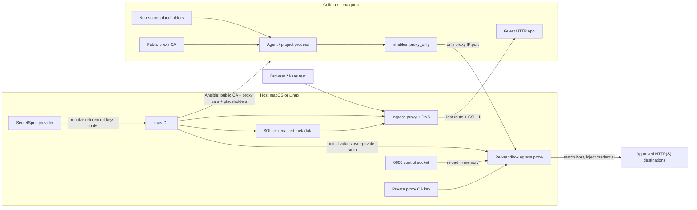
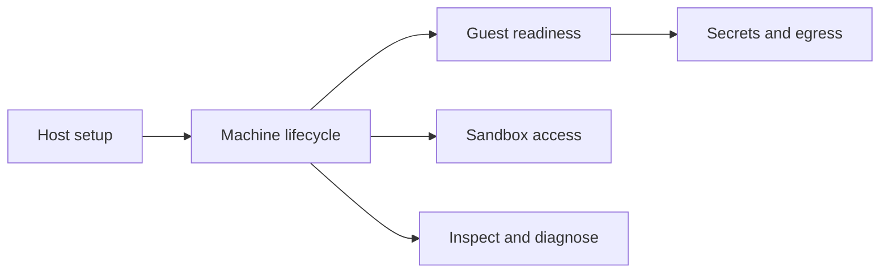

> The diagram above is a fenced `mermaid` block. To render it, add a mermaid integration (e.g. `starlight-mermaid`); without one it previews as a code block.

## Components

| Layer | Role |
|---|---|
| **`kaas` CLI** | VM orchestration, SecretSpec selection, proxy lifecycle, redacted events, and guest configuration |
| **Colima / Lima** | Persistent Ubuntu guests, with SSH published on a per-sandbox localhost port |
| **SecretSpec provider** | Host-side declaration and storage; profile `default ∪ <sandbox>` supplies either deployment path |
| **Host egress proxy** | Holds delegated values in memory, matches HTTP(S) destinations, injects credentials, and owns the private interception CA |
| **Host ingress + DNS** | Loopback HTTP reverse proxy (Host routing + catalog) and optional `*.kaas.test` DNS stub; SSH `-L` publishes guest listeners |
| **Local web UI** | Optional loopback dashboard (`kaas ui`, default `127.0.0.1:18181`) over the same SQLite registry; separate from the ingress catalog |
| **Ansible** | Installs toolchains; writes explicitly injected secrets or, separately, installs only the proxy public CA, variables, placeholders, and nftables rules |
| **SQLite state** | Sandbox, service registry, and redacted egress metadata. It stores no credential values or private CA material |

## End-to-end control flow

1. Host setup (`kaas init` / `kaas project init`) prepares `~/.kaas` and the
   project contract. Machine lifecycle commands then create or start the Colima
   profile; guest readiness commands provision toolchains and agents.
2. `kaas up <name>` is the one-shot path: Galaxy deps → create/start → provision
   → agents → credentials (see below) → checkout → `scripts/kaas-setup`.
3. In `open` mode, `up` runs the traditional optional SecretSpec deployment and
   writes resolved values into the guest.
4. In `proxy_preferred` or `proxy_only`, `up` instead starts the host proxy,
   resolves only policy-referenced keys, and runs `ansible/egress.yml` with
   public/non-secret inputs.
5. Requests from proxy-aware clients reach the host proxy. It checks the host
   policy and injects a configured credential only after a rule match.
6. In `proxy_only`, guest nftables prevents unprivileged direct egress and
   forwards/container egress except to the pinned proxy address.
7. Machine lifecycle, guest readiness, credentials, and observe commands keep VM
   state, project state, proxy-private state, and redacted registry metadata
   separate. `kaas --help` surfaces that split as help groups.
8. When `workspace.services` is declared, `up`/`start`/`services sync` allocates
   host ports, starts the loopback ingress daemon, and maintains SSH local
   forwards so browsers can use `http://service.sandbox.kaas.test` after
   `kaas dns enable`.
9. Optional `kaas ui` serves a loopback management dashboard over the registry
   (sandboxes, services, events). It does not replace the ingress catalog at
   `http://kaas.test/`.

## Why there are two secret paths

SecretSpec answers *which keys exist and where their values are stored*. KaaS
still has to decide whether a guest should **possess** a value or merely be able
to **exercise** it at an approved HTTP destination.

`kaas secrets deploy` resolves values into a protected host temporary file,
passes them through Ansible, and writes guest shell exports. This is the right
mechanism when a trusted local process must read a database password, signing
key, mTLS key, test secret, or another non-HTTP credential. It is not suitable
for keeping a value secret from guest code: that code can read and exfiltrate
it.

Delegated egress keeps HTTP bearer, basic, and named-header values outside the
guest. The capability becomes “authenticate this request to this host” instead
of “read this token.” This limits possession and destination, but not the
provider-side operations the token authorizes and not other data sent to an
allowed host.

## How delegated egress works

1. The project policy contains host rules, injection types, and SecretSpec key
   **names**, never values. Reachability is independent: a host rule without
   `inject_secret` receives no credential.
2. KaaS resolves only referenced keys from `default ∪ <sandbox>`. Initial
   values enter the host proxy over inherited stdin; rotation uses a per-sandbox
   `0600` Unix socket.
3. The proxy holds values in memory. After matching the destination, it
   overwrites the configured bearer/basic/named header. Default-deny policies
   reject unlisted hosts and blind CONNECT tunnels.
4. HTTPS is terminated and re-established by the proxy. Its private CA key
   remains in a host-only `0700` runtime directory with `0600` key permissions.
   Ansible receives only the public certificate, proxy URL, and non-secret
   placeholders.
5. `proxy_preferred` configures compliant clients but permits bypass.
   `proxy_only` additionally installs nftables output/forward rules that allow
   loopback, SSH replies, and the pinned proxy IP/port only.
6. SQLite and events contain only mode, port, status, CA fingerprint, and policy
   hash—not values or secret-bearing headers.

The `proxy_only` boundary covers unprivileged guest workloads. Because nftables
runs inside the VM, guest root or `CAP_NET_ADMIN` can remove it. KaaS does not
claim a guest-root boundary.

## Sandbox identity

`internal/sandbox/identity` owns the secret-free sandbox identity: name,
provider profile, control-repo provenance, workspace identity, SSH endpoint,
desired VM resources, and config provenance. It does not start VMs, resolve
secrets, or carry egress runtime credentials.

Constructors:

- `New` — validate and build a new identity (provider profile = sandbox name;
  Colima also receives that name as the guest `--hostname`)
- `FromFork` — copy workspace/resources/control-repo; regenerate name, profile, endpoint
- `WithSSHConfig` — reconcile endpoint fields from provider SSH config
- `FromState` / `ApplyToState` — map to the existing SQLite row shape without
  touching lifecycle, setup, or egress columns

New sandbox names must be lowercase letters, digits, and internal hyphens only
(`my-app`), at most 63 characters; reserved names such as `default` are
rejected. The same name is the Colima profile, the Ansible inventory host, the
SecretSpec profile, and the guest hostname (`user@my-app`).

## Sandbox contract

`internal/sandbox/contract` owns the secret-free desired-behavior contract:
VM resources, workspace intent, secret mode and key references, redacted egress
policy, provenance, and a stable hash. Resolution precedence is built-in → user
→ project → env → flags. After a contract is persisted, resume treats it as
sole authority (no silent cwd override); legacy sandboxes with no contract row
are adopted once from the current stack. Persisted JSON lives in
`sandbox_contracts` and never includes credential values or private CA material.

## Sandbox lifecycle

`internal/sandbox/lifecycle` owns provider orchestration and state transitions:
create, start, stop, destroy, fork, and reconcile. The CLI parses arguments,
confirms destructive intent, and renders results; it does not decide transitions.



| Help group | CLI commands | Domain owner |
|---|---|---|
| Machine lifecycle | `up`, `create`, `start`, `stop`, `fork`, `destroy` | `internal/sandbox/lifecycle` (+ `up` orchestration) |
| Guest readiness | `provision`, `agents`, `setup`, `check` | Ansible playbooks / project contract |
| Inspect and diagnose | `list`, `inspect`, `doctor`, `events` | registry + reconcile + audit log |

`kaas create` is a raw machine operation (Colima + state DB only). `kaas up`
and `kaas provision` require Ansible assets. Guest readiness and credential
commands assume a registered sandbox; resume paths (`start`, `setup`,
`secrets deploy`, egress) treat the persisted contract as sole authority.

Persisted state is split (D2):

- **Desired** — operator intent: `registered` | `running` | `stopped` | `destroyed`
- **Observed** — last reconciled fact: `absent` | `creating` | `starting` |
  `running` | `stopping` | `stopped` | `destroying` | `failed` | `unknown`

A registry row with `desired=running` is never proof the VM is up; only a
provider status (or reconcile) updates observed. `kaas list --refresh`
reconciles and **reports** typed discrepancies; it never silently rewrites
state.

Destroy (D5) separates provider deletion from registry deletion. Default
destroy retains the registry row when provider delete fails; `--force` is the
escape hatch to drop registry metadata anyway. Fork (D4) restores the source to
its exact prior observed state; a source-restore failure after a healthy target
returns a typed partial error (non-zero) without deleting the target.

Operation claims (`sandbox_operations`) and short-lived `port_reservations`
stage concurrency for create/fork port allocation.

## Lifecycle and egress ownership

- `kaas up` uses delegated setup instead of automatic guest secret deployment
  whenever mode is `proxy_preferred` or `proxy_only`.
- `kaas egress reload` re-resolves values and atomically replaces in-memory
  proxy credentials without guest deployment.
- `stop` terminates the proxy; `start` restores and reconfigures it.
- `destroy` removes the host-private CA, socket, and runtime directory.
- `fork` clones public guest disk state but clears egress metadata and never
  copies the host proxy runtime or credentials; configure the target explicitly.

See [Delegated Egress](../guides/egress.md) for usage and for choosing this path
versus guest injection.

## Defaults and boundaries

- **Guest `$HOME`** comes from Ansible facts (`ansible_user_dir`). Colima/Lima often uses `/home/<user>.guest`, not `/home/<user>`.

## Internal packages

```
internal/cli/             command-line entrypoints for every subcommand
internal/config/          kaas.yaml / env / flag configuration loading (koanf)
internal/state/           SQLite registry + migrations
internal/colima/          Colima client wrappers + lifecycle
internal/ansible/         playbook runner + inventory generation
internal/secretspec/      SecretSpec CLI client (set/export/check/resolve)
internal/sandbox/         SSH port allocation
internal/sandbox/identity sandbox name grammar and identity value types
internal/sandbox/lifecycle provider orchestration, desired/observed state, fake provider tests
internal/sandbox/contract contract types, resolution (D3/D6), redacted persistence
```
